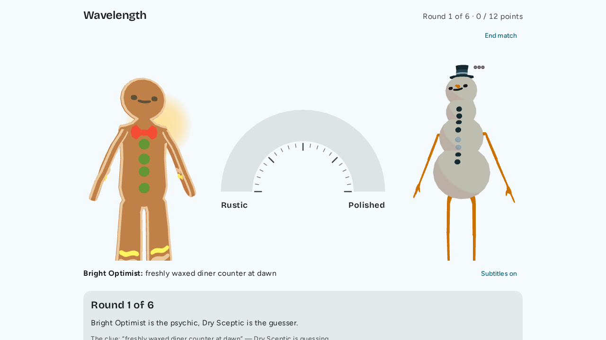
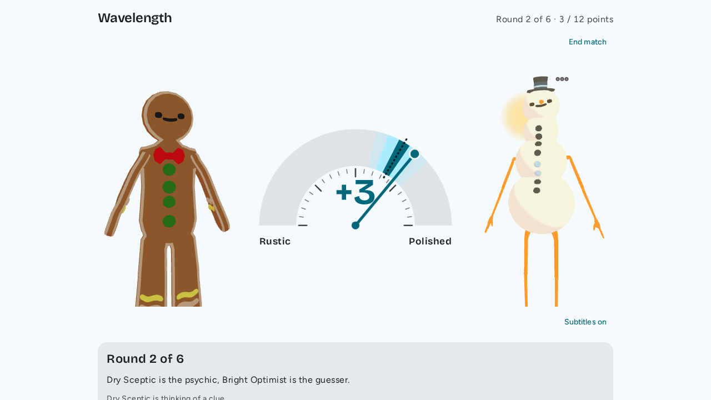
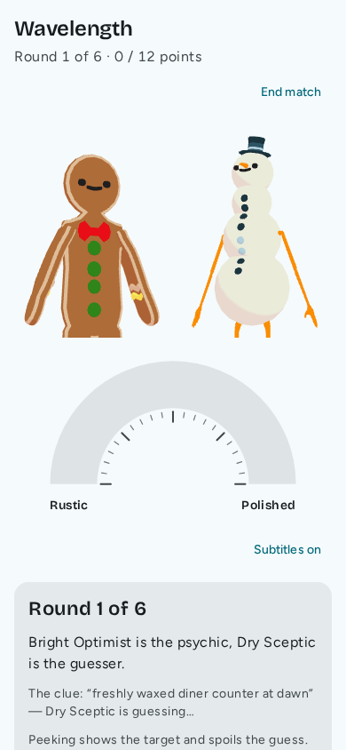

# wavelength

Cooperative Wavelength for you and an LLM, or for two LLMs, in your terminal or your browser. One of you sees a hidden target on a dial between two opposites and gives a one-line clue; the other guesses where it is. Points are shared, roles swap every round, and the target stays hidden from the guesser by the game engine, not by trust. In the browser the AI players have faces and voices, think before they move, and work the needle where you can watch.

```
# an example turn: you (psychic) clue, the agent (guesser) dials, the target is revealed
Round 1/6  score 0/12  you: psychic
Light [..............................T..........] Heavy
The target is 75 (0 = Light, 100 = Heavy).
> a lazy afternoon

agent plays 70  ("Hmm, lazy feels heavy, but not extreme.")
Round 1 revealed: clue "a lazy afternoon"
Light [............................G.T..........] Heavy
Guess 70, target 75: 3 points
```

## What it looks like



A round finishing on the stage dial, and the same match on a phone:

| Reveal | Phone |
| --- | --- |
|  |  |

A 20 second match between two AI players: [docs/img/wavelength-demo.mp4](docs/img/wavelength-demo.mp4) (music only; the avatars speak when you run it with `make web-voice`). Recorded by `docs/media/capture-demo.mjs`.

## Quick start

You need Python 3.12+, [`uv`](https://docs.astral.sh/uv/) and `make`.

```
git clone https://github.com/leejianrong/wavelength && cd wavelength
make play-bot        # no API key: play against a scripted bot
make web             # the same in your browser (needs Node 24); pick bot, AI partner, or watch two AIs
```

To play against an LLM agent, get an [OpenRouter](https://openrouter.ai) key and:

```
cp .env.example .env     # then set OPENROUTER_API_KEY in .env
make play                # you vs an LLM agent
```

With a [vikaki](https://github.com/leejianrong/vikaki) hub the players get faces and the AI a voice: `make web-voice VIKAKI_DIR=~/vikaki` ([docs/voice.md](docs/voice.md)).

`make` on its own lists every command.

## Usage

| Command | What happens |
|---------|--------------|
| `make play` | You play a 6-round match with an LLM agent. |
| `make watch` | Two LLM agents play each other. |
| `make play-bot` | You play a scripted bot that needs no key. |
| `make web` | The same match in your browser at `http://127.0.0.1:8765/`: a dial you drag, a clue box, the reveal with scoring zones. Pick a bot, an AI partner or watch two AIs. Phone-friendly. An AI guesser moves the needle in steps and says why; an AI psychic reacts after the reveal. |
| `make web-voice VIKAKI_DIR=~/vikaki` | The same with faces and voices through a vikaki hub (`VOICE=real` for Kokoro). See [docs/voice.md](docs/voice.md). |
| `make eval-llm` | Score two LLM agents against a random guesser and report guard counts (real API calls, costs money; `EVAL_ROUNDS=`, `EVAL_SEEDS=`, `MAX_CALLS=` bound it). |
| `uv run wavelength web --players players.example.toml` | Named AI players with personalities (name, model, personality text) to pick for an AI seat; see `players.example.toml`. `make eval-llm PLAYERS=players.example.toml PLAYER="Dry Sceptic"` compares them. |
| `make play MODEL=openai/gpt-4o-mini ROUNDS=3` | Pick the model (any OpenRouter slug) and match length. |

The default model is `deepseek/deepseek-v4.1-flash`. Its neighbour `deepseek/deepseek-v4-flash` (no `.1`) can be blocked by an OpenRouter workspace guardrail, which answers `404 ... Model blocked by guardrail` (check <https://openrouter.ai/workspaces/default/guardrails>); no call is made or charged.

When you are the psychic you type a clue; when you are the guesser you type a number from 0 to 100. While an LLM guesser is thinking, you can type a line to chat with it; on your own turn, start the line with `chat:`.

In the browser (Chrome) you can say your clue or think aloud with the microphone button; Chrome sends the audio to Google to turn it into text, and what you say while guessing goes to an AI partner's model after the reveal ([docs/voice.md](docs/voice.md)).

A clue is one line of 1 to 6 words. It may not contain numbers, position words ("left", "middle"), or the spectrum's own words. The game rejects it with the reason and asks again.

At the end you get a table of every round (psychic, clue, guess, target, points). You win together if the total reaches the goal (12 points by default). A guess within 2 of the target scores 4, within 6 scores 3, within 10 scores 2.

## Let a coding agent play

`wavelength-mcp` is a stdio [MCP](https://modelcontextprotocol.io) server that seats an external agent (Claude Code, for example) against a bot or an LLM. To add it to Claude Code from your clone:

```
claude mcp add wavelength -- uv run --directory "$PWD" wavelength-mcp
```

Then ask the agent to play Wavelength. It gets three tools, and each result is its own seat's view only:

| Tool | Returns |
|------|---------|
| `get_observation` | Role, phase, spectrum, clue, past rounds, and instructions. |
| `list_legal_actions` | `[{"free_text": ...}]` when it owes a clue, or the whole dial `0..100` when it guesses. |
| `submit_action` | Its next observation, after the opponent has played. `action` is a string for a clue and a number for a guess. A rejected clue comes back as an error that says why. |

The match is over when an observation has `"phase": null`. Options: `--opponent-spec llm:openrouter/<model>` (needs `OPENROUTER_API_KEY`), `--opponent-first`, `--config rounds=3`.

The agent cannot see an unrevealed target: it can only read its own observation, it cannot ask for the other seat's, and no tool returns the full state. That holds for what the tools return; it does not stop an agent from reading this repository's source or a save file, so it is a guard against accidents and prompt mistakes, not against a determined cheat.

## Configuration

Pass game settings through the framework's `--config KEY=VALUE`:

```
uv run wavelength play wavelength --config rounds=6 --config seed=7 \
  --seat you=human --seat agent=llm:openrouter/openai/gpt-4o-mini
```

| Key | Default | Meaning |
|-----|---------|---------|
| `rounds` | 6 | Number of rounds (at most the deck size, 232). |
| `target_score` | 12 | Points needed to win. |
| `seed` | random | The same seed gives the same spectra and targets. |
| `deck` | bundled | Path to your own JSON deck, shaped like `src/wavelength/data/spectra.json`. |

`--json` prints one JSON line per turn showing only what your seat may see; `--omniscient` shows everything.

The browser server (`uv run wavelength web`) has a few switches of its own:

| Flag | Default | Meaning |
|------|---------|---------|
| `--think` / `--no-think` | on | AI players write working notes before each move (twice the calls, better play: [ADR-0010](docs/adr/0010-players-think-before-they-move.md)). |
| `--needle-steps` / `--no-needle-steps` | on | An AI guesser works the needle in up to 4 steps (about 3 calls a guess). Off gives one move and a derived walk ([ADR-0012](docs/adr/0012-the-ai-works-the-needle-in-public-steps.md)). |
| `--walk-pause` | 0.8 | Seconds between needle positions: the derived walk, or the pause after a step when there is no voice. |
| `--max-calls` | 200 | Hard cap on model calls per match, reactions and steps included. |
| `--voice off\|fake\|real` | off | Faces and voices through a vikaki hub. |

Built on [`agent-game-framework`](https://github.com/leejianrong/agent-game-framework). The design is in [`docs/PLAN.md`](docs/PLAN.md) and [`docs/adr/`](docs/adr).

## Status

Every slice in [`docs/SLICES.md`](docs/SLICES.md) is built. The AI players score about 2 points a round against 0.57 for a random guesser (see the measurements in ADR-0010); whether needle steps play better is not yet measured. Bugs and ideas: [open an issue](https://github.com/leejianrong/wavelength/issues).

## Contributing

See [`CONTRIBUTING.md`](CONTRIBUTING.md).

## License

Apache License 2.0, see `LICENSE`. This is an independent implementation with original content. "Wavelength" is a commercial game by Palm Court / CMYK; this project is not affiliated with or endorsed by them.
